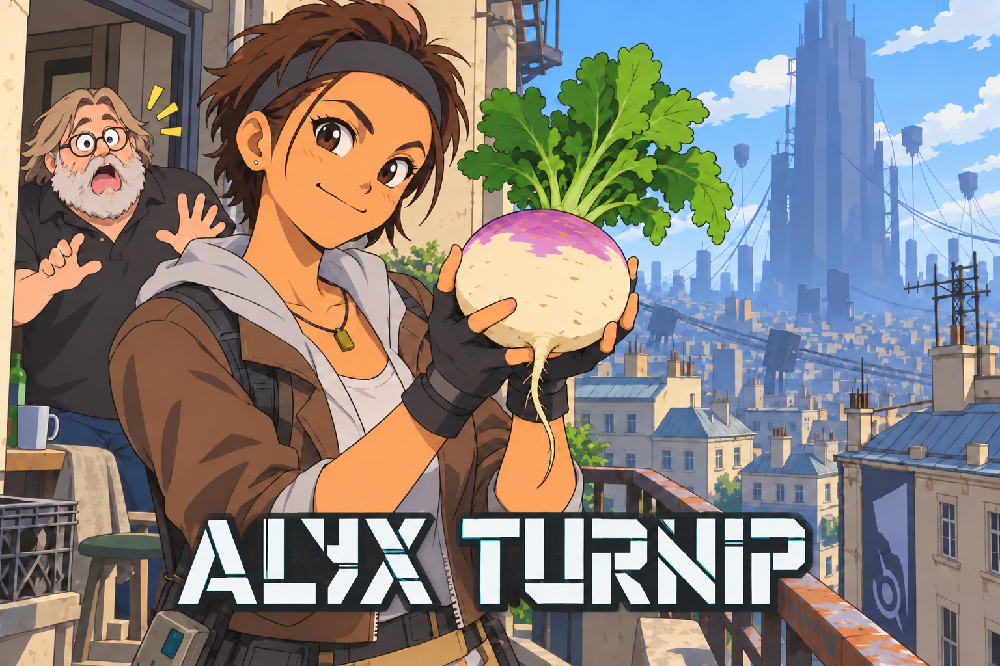

<p align="center">
  
</p>

# Alyx Turnip

**A custom Mesa Turnip driver for the Alyx Jailbreak standalone VR project.**

[Русский](README.ru.md) · **English** · [Build instructions](docs/BUILD.md) · [Source provenance](docs/PROVENANCE.md)

Alyx Turnip brings together our Quest compatibility changes, rendering fixes,
selected Mesa backports, FDM/VRS work, and shader-compiler CPU optimizations in
Android ARM64 driver variants. Choose the compatibility reference, MSAA2/VRS,
or the experimental final-map cache variant below. Device-specific image import
and OpenXR integration are handled by the host application.

This is an independent downstream project, not an official release of Mesa,
Meta, PICO, Qualcomm, or Valve.

## What is included

- **Rendering and memory fixes:** FDM clear/store handling, scoped clears,
  command-stream reset and synchronization, allocation and submission cleanup.
- **Reduced repeated work:** shader-state and binning-binary/upload reuse.
- **Selected upstream fixes:** viewport/scissor handling, GMEM fences,
  descriptor ownership, memory-budget queries, and IR3/NIR improvements.
- **An optional FDM-to-hardware-VRS path** for eligible A7xx passes.
  `compat` supports single-sample passes; `msaa-vrs` adds MSAA 2x with
  color/depth resolves and supported shading rates up to 4x2. Driver mode
  defaults to off and is enabled by host policy.
- **Final VRS-map caching** in `msaa-vrs-cache`, keyed by sample count, avoids
  repeating MSAA rate clamping on cache hits. This variant remains experimental.
- **Compiler CPU optimizations:** PGO, ThinLTO and Cortex-A78C targeting for
  selected compiler libraries, range-analysis fast paths, SSA scratch-set
  pooling, and deferred safe-constant variants.

These changes do not guarantee a particular FPS gain or eliminate first-use
shader compilation stutter. Feature availability depends on the GPU and host.

## Headset status

| Headset | Status in the universal application |
| --- | --- |
| Quest 3 | Historical v907 checks plus subsequent MSAA2/VRS GPU tests and Quest demo acceptance; see the variant notes |
| PICO 4 | Earlier dedicated v891 fix reported working; current universal build needs device testing |
| Quest 2 / Quest Pro | Intended universal targets; device validation remains outstanding |
| PICO 4 Ultra | Intended universal target; current universal build needs device testing |

The host recognizes the pinned Turnip Adreno 650 and 740/740v3 paths. This
table describes **application integration**, not a certification that the
standalone library works in every Vulkan application. Short Quest 3 tests do
not establish extended gameplay, thermal stability, or every controller mode.

## Driver variants — 2026-10-17

| Variant | Library | Intended use |
| --- | --- | --- |
| `compat` (default) | [Compatibility reference](prebuilt/android-arm64/libalyx_turnip.so) | Original v907 driver; preserved unchanged |
| `msaa-vrs` | [MSAA2 + VRS](prebuilt/android-arm64/msaa-vrs/libalyx_turnip.so) | Quest-tested; selected by the 0.185 universal build recipe |
| `msaa-vrs-cache` | [Final-map cache](prebuilt/android-arm64/msaa-vrs-cache/libalyx_turnip.so) | Quest test/demo integration; not the public universal preset |

The universal recipe selecting `msaa-vrs` does not establish hardware validation
on every headset. PICO and Quest 2/Pro require their own compatibility checks.
The new cache variant is explicitly excluded from public/universal/PICO builds
by the parent application's guards. [Variant details and full hashes](docs/VARIANTS.md).

## Driver and source

The reference library is [`prebuilt/android-arm64/libalyx_turnip.so`](prebuilt/android-arm64/libalyx_turnip.so).
It is byte-identical to the `libquest3turnip.so` packaged with universal v907;
only the file name is different.

```text
SHA256 1559bf7493ae397c274c9743befcbcc4bd6cfd6e1232f4f41f0f45e5374c25bb
```

This repository distributes the driver source as a **pinned Mesa base plus a
complete patch series**, including the PGO profile and original build input
manifests. `scripts/build.py` downloads or reads the exact Mesa archive,
checks its hash, and reconstructs the full source tree before compilation.
The large upstream source tree is not duplicated in Git.

```sh
python3 scripts/verify.py
python3 scripts/build.py --variant msaa-vrs --out /tmp/alyx-turnip-source --prepare-only
```

Source preparation requires Linux/WSL, Python 3.12+ and Git. For a full build,
follow the [English / Russian build guide](docs/BUILD.md).

## Integration

This is an application-loaded Vulkan driver, not a system-wide Android driver
installer. The existing Alyx host loads it through its driver-loading layer
and supplies the matching image-import and headset policies. The host/import
layer is a separate component and is not part of this driver repository.

Keep the host's expected library name and update its pinned checksums when
integrating a rebuilt binary. Repository branding does not change Vulkan
device names or internal driver identities. A rebuilt library requires device
validation before replacing a known-working application package.

## Repository map

| Path | Contents |
| --- | --- |
| `patches/` | Complete Quest baseline delta against the pinned Mesa source |
| `tests/turnip_*` | Ordered driver patches and VRS source/policy test inputs |
| `dependencies/` | Original compiler profile, helper and historical build inputs |
| `scripts/` | Portable source reconstruction, build and integrity checks |
| `prebuilt/` | Three exact historical Android ARM64 driver variants |
| `provenance/` | Source revisions, patch hashes and historical validation records |
| `licenses/` | Preserved upstream license texts |

## Credits and licensing

Built on [Mesa / Freedreno / Turnip](https://gitlab.freedesktop.org/mesa/mesa),
with Quest compatibility work from
[Jbbrack03/Quest-3-Turnip-Driver](https://github.com/Jbbrack03/Quest-3-Turnip-Driver),
and the additional changes documented in [provenance](docs/PROVENANCE.md).
Upstream authors retain their copyrights. See [LICENSE](LICENSE),
[NOTICE](NOTICE), and the per-file SPDX/license headers. The supplied logo
is project artwork and is not covered by the source-code MIT grant.
